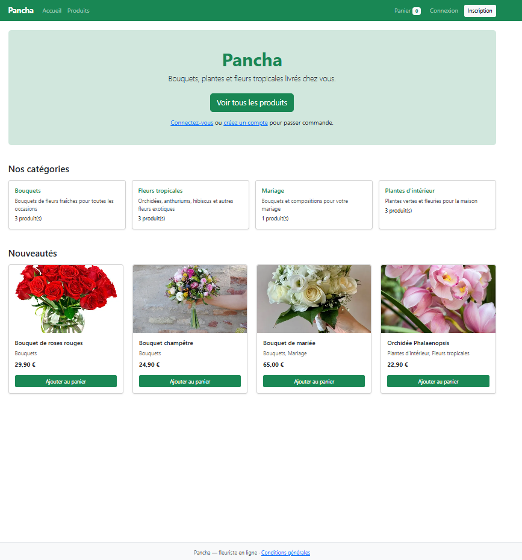
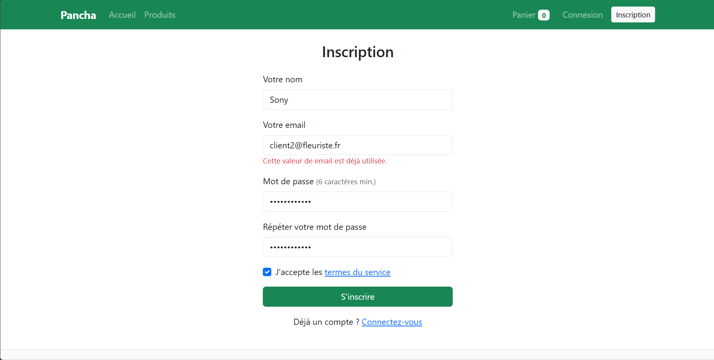
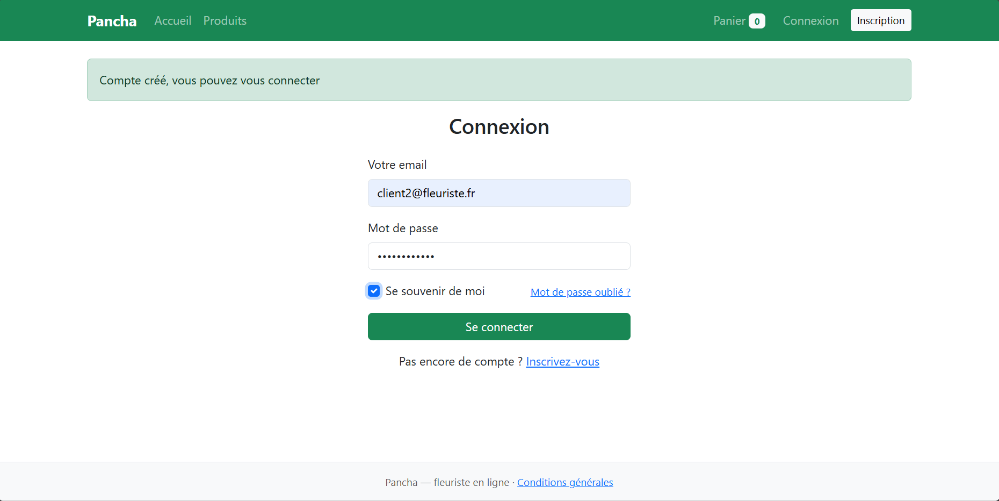
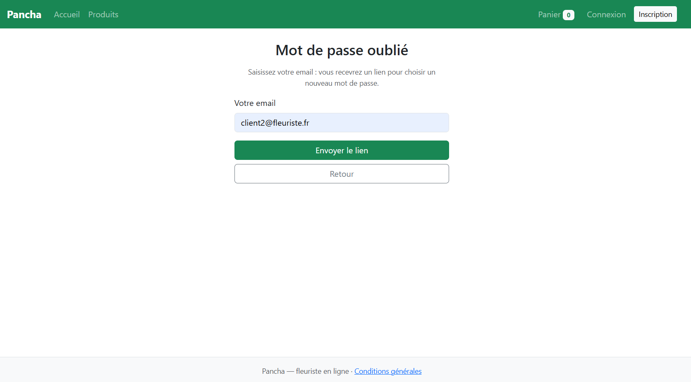
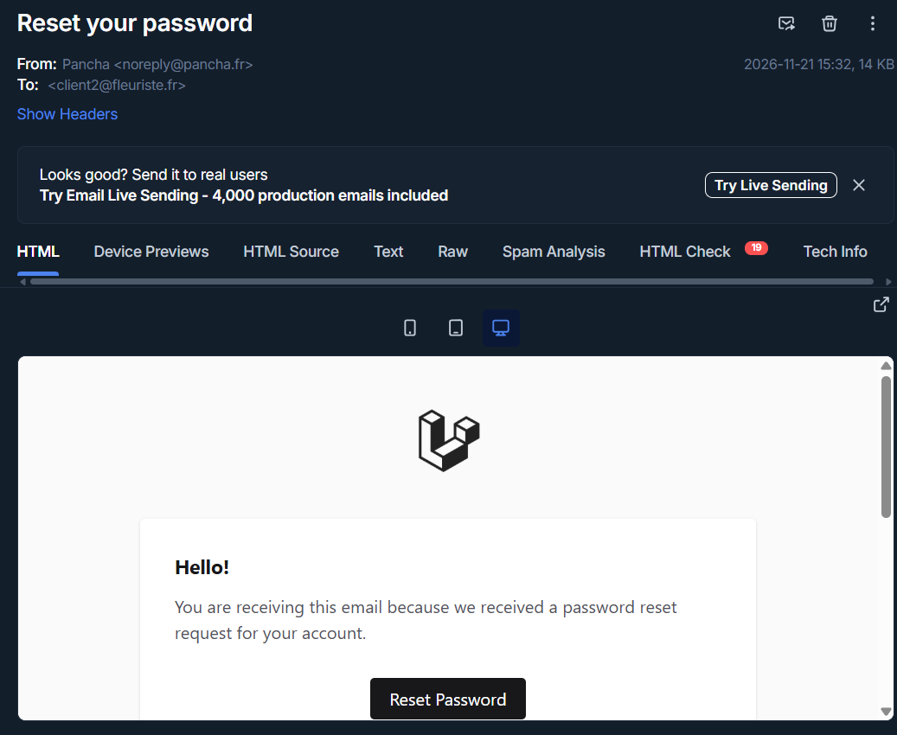
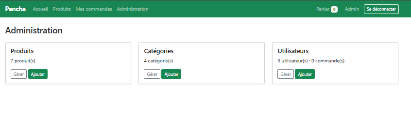

# Pancha — fleuriste en ligne

Projet Laravel de L3 Informatique (Université de Guyane, 2026/2027) : boutique en ligne de bouquets, plantes et fleurs tropicales.



> 📘 Explication détaillée du projet (base de données, routes, sécurité, choix techniques) : **[docs/documentation.md](docs/documentation.md)**

## Fonctionnalités

| Module | Ce qui est fait |
|---|---|
| **Vitrine** | Accueil avec les catégories et les derniers produits, liste filtrable par catégorie, fiche produit |
| **Panier** | Stocké en session, utilisable **sans être connecté**. Boutons − / + / supprimer, sous-total par ligne et total |
| **Commande** | Connexion obligatoire pour valider. Formulaire de livraison, enregistrement de la commande, historique « Mes commandes » |
| **Comptes** | Inscription, connexion (« se souvenir de moi »), déconnexion, suppression du compte |
| **Mot de passe oublié** | Envoi automatique d'un email avec un lien de réinitialisation |
| **Catégories** | Un produit peut appartenir à plusieurs catégories (relation plusieurs-à-plusieurs) |
| **Administration** | Réservée au rôle `admin` : CRUD des produits (image, stock, catégories), des catégories et des utilisateurs |
| **Bonus** | Gestion des stocks : rupture de stock, contrôle à l'ajout au panier et à la commande |

Technologies : Laravel 13, PHP 8.3+, MySQL, Bootstrap 5 (site responsive).

## Installation

Prérequis : PHP 8.3+, Composer, MySQL (par exemple WampServer).

```bash
git clone https://github.com/qlspanda17/Site_E_commerce_L3.git
cd Site_E_commerce_L3
composer install
cp .env.example .env
php artisan key:generate
```

Dans `.env`, vérifier les accès MySQL (`DB_DATABASE`, `DB_USERNAME`, `DB_PASSWORD`). Créer la base si elle n'existe pas (par défaut `laravel`).

Emails : par défaut `MAIL_MAILER=log`, donc les emails sont écrits dans `storage/logs/laravel.log`. Pour les recevoir dans une boîte de test, renseigner un compte [Mailtrap](https://mailtrap.io) (`MAIL_MAILER=smtp`, `MAIL_HOST=sandbox.smtp.mailtrap.io`, identifiants Mailtrap).

Créer les tables et les données de test, puis lancer le serveur :

```bash
php artisan migrate --seed
php artisan serve
```

Le site est accessible sur http://127.0.0.1:8000.

## Comptes de test (créés par le seeder)

| Rôle | Email | Mot de passe |
|---|---|---|
| Administrateur | admin@fleuriste.fr | mdp |
| Client | client@fleuriste.fr | mdp |

## Captures d'écran

| Inscription | Connexion |
|---|---|
|  |  |

| Mot de passe oublié | Email de réinitialisation reçu |
|---|---|
|  |  |

**Administration**



## Organisation du code

```
app/Http/Controllers/     contrôleurs (un par module : panier, commande, admin produits…)
app/Http/Middleware/      EstAdmin : bloque l'administration aux non-admins
app/Models/               modèles Eloquent : Product, Categorie, Order, OrderItem, User
database/migrations/      création des tables
database/seeders/         données fictives (comptes, catégories, produits)
resources/views/          vues Blade (layout commun dans layouts/, administration dans admin/)
routes/web.php            routes regroupées par niveau d'accès
lang/fr/validation.php    messages d'erreur en français
```
