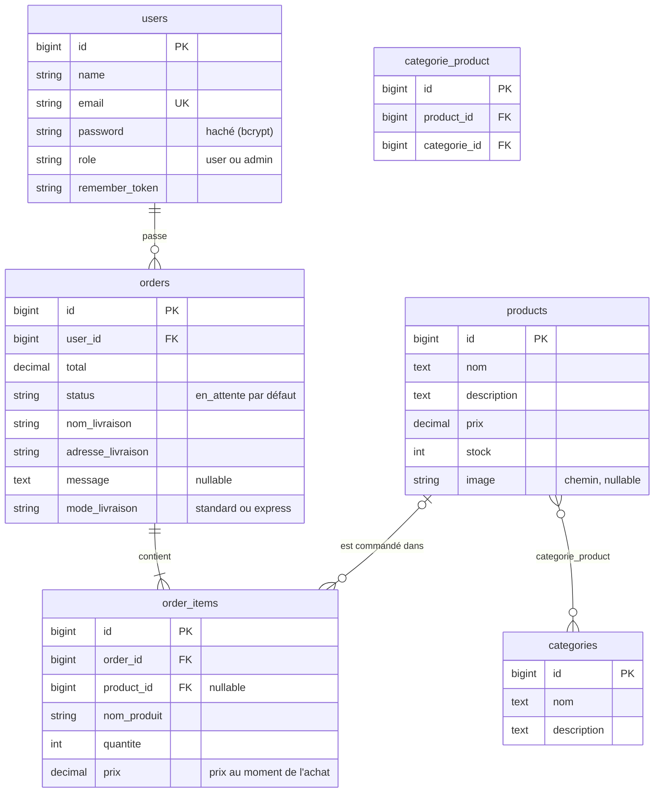

# Documentation technique — Pancha

Ce document explique comment le site est construit : la base de données, les routes, chaque module et les choix techniques. Pour installer le projet, voir le [README](../README.md).

## Sommaire

1. [Présentation](#1-présentation)
2. [Architecture Laravel (MVC)](#2-architecture-laravel-mvc)
3. [Base de données](#3-base-de-données)
4. [Routes et niveaux d'accès](#4-routes-et-niveaux-daccès)
5. [Authentification et sécurité](#5-authentification-et-sécurité)
6. [Le panier](#6-le-panier)
7. [La commande](#7-la-commande)
8. [Mot de passe oublié](#8-mot-de-passe-oublié)
9. [Administration](#9-administration)
10. [Interface et responsive](#10-interface-et-responsive)
11. [Validation et gestion des erreurs](#11-validation-et-gestion-des-erreurs)
12. [Respect des consignes](#12-respect-des-consignes)
13. [Pistes d'amélioration](#13-pistes-damélioration)

---

## 1. Présentation

**Pancha** est un fleuriste en ligne. Un visiteur peut parcourir les produits par catégorie et remplir un panier. Pour commander, il doit avoir un compte et être connecté. Un administrateur gère le catalogue (produits, catégories) et les comptes utilisateurs.

| Élément | Choix |
|---|---|
| Framework | Laravel 13 |
| Langage | PHP 8.3+ |
| Base de données | MySQL (WampServer en local) |
| Interface | Blade + Bootstrap 5.3 (CDN) |
| Emails | SMTP Mailtrap (boîte de test) |

## 2. Architecture Laravel (MVC)

Laravel suit le modèle **MVC** :

- **Modèle** (`app/Models`) : une classe Eloquent par table. Elle permet de lire et d'écrire en base sans écrire de SQL, et définit les relations entre les tables.
- **Vue** (`resources/views`) : les pages HTML écrites en Blade (`{{ }}`, `@if`, `@foreach`…).
- **Contrôleur** (`app/Http/Controllers`) : il reçoit la requête, valide les données, utilise les modèles et renvoie une vue ou une redirection.

Chemin d'une requête :

```
Navigateur → routes/web.php → middleware (auth, admin…) → Contrôleur → Modèle (BDD) → Vue Blade → Navigateur
```

### Contrôleurs

| Contrôleur | Rôle |
|---|---|
| `WelcomeController` | Page d'accueil (catégories + derniers produits) |
| `ProduitController` | Liste des produits (avec filtre par catégorie) et fiche produit |
| `PanierController` | Afficher, ajouter, retirer, supprimer une ligne du panier |
| `CommandeController` | Formulaire de livraison, validation de la commande, historique |
| `InscriptionController` | Création de compte |
| `ConnexionController` | Connexion, déconnexion, suppression du compte |
| `MotDePasseController` | Demande de lien et réinitialisation du mot de passe |
| `AdminController` | Tableau de bord de l'administration |
| `ProduitAdminController` | CRUD des produits |
| `CategorieController` | CRUD des catégories |
| `UtilisateurController` | CRUD des utilisateurs |

## 3. Base de données

Toutes les tables sont créées par les **migrations** (`database/migrations`). La commande `php artisan migrate --seed` crée la base complète et la remplit avec des données fictives.

### Schéma



### Produits et catégories : une relation plusieurs-à-plusieurs

Le sujet impose qu'une catégorie contienne plusieurs produits **et** qu'un produit puisse appartenir à plusieurs catégories. Une simple colonne `categorie_id` dans `products` ne le permet pas : il faut une **table pivot**, `categorie_product`, qui contient une ligne par association produit ↔ catégorie.

Dans les modèles, la relation est déclarée des deux côtés avec `belongsToMany` :

```php
// app/Models/Product.php
public function categories()
{
    return $this->belongsToMany(Categorie::class);
}

// app/Models/Categorie.php
public function products()
{
    return $this->belongsToMany(Product::class);
}
```

Exemple : l'orchidée est à la fois dans « Plantes d'intérieur » et « Fleurs tropicales ». Dans l'administration, on coche les catégories et le contrôleur enregistre le choix avec `sync()`. Cette méthode ajoute les associations cochées et supprime celles qui ont été décochées :

```php
$product->categories()->sync($request->input('categories', []));
```

Les clés étrangères de la table pivot sont en `onDelete('cascade')` : supprimer une catégorie supprime ses associations, **mais pas les produits**.

### Commandes : historique conservé

- `orders` : une ligne par commande (client, adresse, total, mode de livraison).
- `order_items` : une ligne par produit commandé. **Le prix est recopié** au moment de l'achat : si l'admin change le prix plus tard, les anciennes commandes gardent le bon montant.
- `nom_produit` et `product_id` nullable : si un admin supprime un produit déjà commandé, `product_id` passe à `null` (`nullOnDelete`) et le nom reste dans l'historique. Sans cela, la suppression provoquerait une erreur SQL de clé étrangère.
- Supprimer un utilisateur supprime ses commandes (`cascadeOnDelete` sur `orders.user_id`).

### Seeder

`database/seeders/DatabaseSeeder.php` crée :
- 2 comptes : un administrateur et un client ;
- 4 catégories : Bouquets, Plantes d'intérieur, Fleurs tropicales, Mariage ;
- 7 produits avec image et stock, rattachés à une ou plusieurs catégories.

## 4. Routes et niveaux d'accès

Toutes les routes sont dans `routes/web.php`. Elles sont regroupées selon qui a le droit d'y accéder. Les URLs et les noms de routes sont tous en **snake_case**.

| Groupe | Middleware | Exemples |
|---|---|---|
| Public | aucun | `/`, `/produits`, `/produits/{id}`, `/panier`, `/terme` |
| Visiteurs non connectés | `guest` | `/inscription`, `/connexion`, `/mot_de_passe_oublie` |
| Utilisateurs connectés | `auth` | `/commande`, `/mes_commandes`, `/deconnexion`, `/supprimer_compte` |
| Administrateurs | `auth` + `admin` | `/admin`, `/admin/produits`, `/admin/categories`, `/admin/utilisateurs` |

- `guest` (natif Laravel) : un utilisateur déjà connecté ne peut pas retourner sur la page d'inscription ou de connexion.
- `auth` (natif Laravel) : un visiteur non connecté est redirigé vers `/connexion`. Cette redirection est configurée dans `bootstrap/app.php` avec `redirectGuestsTo`.
- `admin` : middleware personnel (voir ci-dessous).

Chaque route a un **nom** (`->name('...')`), et les vues génèrent les liens avec `route('nom')`. Si une URL change, les liens suivent automatiquement.

Les actions qui modifient des données utilisent la bonne méthode HTTP :
- `POST` pour créer ;
- `PUT` pour modifier ;
- `DELETE` pour supprimer, via `@method('PUT')` / `@method('DELETE')` dans les formulaires.

Un lien `<a>` ne déclenche donc jamais de modification.

## 5. Authentification et sécurité

### Guard et connexion

La connexion utilise le **guard `web`** natif de Laravel (`config/auth.php`). Il stocke l'utilisateur connecté en session :

```php
// app/Http/Controllers/ConnexionController.php
if (Auth::attempt($credentials, $request->boolean('souvenir'))) {
    $request->session()->regenerate();
    ...
}
```

- `Auth::attempt` cherche l'utilisateur par email et compare le mot de passe avec le **hash bcrypt** enregistré. Le mot de passe n'est jamais stocké en clair (`Hash::make` à l'inscription).
- Le deuxième paramètre active **« se souvenir de moi »** : un cookie `remember_token` garde l'utilisateur connecté.
- `session()->regenerate()` change l'identifiant de session après la connexion, pour se protéger de la **fixation de session**. Le contenu de la session, donc le panier, est conservé.
- `redirect()->intended(...)` renvoie l'utilisateur vers la page qu'il voulait voir avant d'être redirigé vers la connexion (par exemple la validation de commande).

À la déconnexion, la session est invalidée et le jeton CSRF régénéré.

### Rôles et middleware `EstAdmin`

La table `users` a une colonne `role` (`user` par défaut, ou `admin`). Le middleware `app/Http/Middleware/EstAdmin.php` laisse passer uniquement les administrateurs :

```php
if (! $request->user() || $request->user()->role != 'admin') {
    return redirect()->route('welcome_index')->with('error', 'Accès réservé aux administrateurs');
}
return $next($request);
```

Il est enregistré sous le nom `admin` dans `bootstrap/app.php`, puis appliqué au groupe de routes `/admin`. Un client qui tape `/admin` dans la barre d'adresse est renvoyé vers l'accueil.

### Autres protections

| Risque | Protection |
|---|---|
| Faille CSRF (formulaire envoyé depuis un autre site) | `@csrf` dans chaque formulaire, vérifié automatiquement par Laravel |
| Faille XSS (code HTML/JS injecté) | `{{ }}` dans Blade échappe automatiquement le texte affiché |
| Injection SQL | Eloquent et le Query Builder utilisent des requêtes préparées |
| Mots de passe | Hachés avec bcrypt, 6 caractères minimum, confirmation obligatoire |
| Email déjà utilisé | Règle `unique:users` |
| Admin qui se bloque lui-même | Un admin ne peut ni supprimer son propre compte ni retirer son rôle admin |

## 6. Le panier

Le panier est stocké **dans la session**. La session est identifiée par un **cookie** dans le navigateur, et son contenu est enregistré côté serveur dans la table `sessions`. C'est l'utilisation « intelligente des cookies » demandée : le navigateur ne contient qu'un identifiant, donc le client ne peut pas modifier les prix ou les quantités.

Le panier est un simple tableau `[id_produit => quantité]` :

```php
session()->put('panier', [3 => 2, 5 => 1]); // 2 × produit 3, 1 × produit 5
```

Comme il ne dépend pas du compte, **un visiteur non connecté peut remplir son panier**. Il reste en place quand le visiteur se connecte.

| Action | Route | Ce qui se passe |
|---|---|---|
| Ajouter | `POST /panier/ajouter/{id}` | Vérifie que le produit existe (sinon 404) et que le stock suffit, puis +1 |
| Retirer | `POST /panier/retirer/{id}` | −1, et la ligne disparaît à 0 |
| Supprimer | `POST /panier/supprimer/{id}` | Retire la ligne entière |
| Afficher | `GET /panier` | Recharge chaque produit depuis la BDD, calcule les sous-totaux et le total |

Les prix ne sont **jamais** stockés dans la session : ils sont toujours relus en base, ce qui évite d'afficher un prix périmé. Si un produit du panier a été supprimé par un admin, il est retiré automatiquement.

## 7. La commande

1. Le client clique sur **Passer commande**. La route `/commande` est protégée par `auth` : s'il n'est pas connecté, il passe par la connexion puis revient ici.
2. Il remplit le formulaire de livraison : nom, adresse, petit mot, mode de livraison, acceptation des conditions générales.
3. `CommandeController@valider` :
   - valide les champs ;
   - revérifie le stock de chaque produit ;
   - dans une **transaction** (`DB::transaction`), crée la commande, ses lignes, et décrémente le stock. Si une étape échoue, rien n'est enregistré, ce qui évite une commande à moitié créée ;
   - vide le panier.
4. Le client est redirigé vers **Mes commandes**, qui liste ses commandes avec le détail et le total.

## 8. Mot de passe oublié

Cette fonctionnalité utilise le système natif de Laravel (`Password` broker) et la table `password_reset_tokens`.

1. Sur `/mot_de_passe_oublie`, l'utilisateur saisit son email.
2. `Password::sendResetLink()` crée un **jeton** unique (haché en base, valable 60 minutes) et envoie **automatiquement** un email contenant un lien.
3. Le lien est construit dans `app/Providers/AppServiceProvider.php` avec `ResetPassword::createUrlUsing`, pour pointer vers la route du site, `mot_de_passe_reset`.
4. L'utilisateur choisit un nouveau mot de passe. `Password::reset()` vérifie le jeton et l'email, puis enregistre le nouveau mot de passe haché.
5. Si le jeton est faux ou expiré, un message d'erreur s'affiche.

Le message affiché après la demande est le même que l'email existe ou non. Ainsi, on ne révèle pas quelles adresses ont un compte. En développement, les emails sont envoyés vers **Mailtrap**, une boîte de test qui n'envoie rien aux vraies adresses.

## 9. Administration

Accessible depuis le lien **Administration** de la barre du haut, uniquement pour les comptes `admin`. Le tableau de bord affiche le nombre de produits (et de ruptures de stock), de catégories, d'utilisateurs et de commandes.

| Module | Créer | Lire | Modifier | Supprimer |
|---|---|---|---|---|
| Produits | nom, description, prix, stock, image, catégories | liste avec image, catégories, prix, stock | tous les champs, nouvelle image | conserve l'historique des commandes |
| Catégories | nom, description | liste avec nombre de produits | nom, description | supprime les associations, pas les produits |
| Utilisateurs | nom, email, mot de passe, rôle | liste avec rôle et date d'inscription | mot de passe facultatif | supprime aussi ses commandes |

Les formulaires de création et de modification partagent les mêmes champs. Ils sont regroupés dans un fichier `champs.blade.php` inclus avec `@include`, ce qui évite de dupliquer le code.

**Images** : le fichier envoyé est validé (`image`, 2 Mo max) puis copié dans `public/images/produits/` avec un nom unique. La base n'enregistre que le chemin. Un produit sans image affiche `placeholder.svg`.

## 10. Interface et responsive

- Toutes les pages héritent d'un **layout commun**, `resources/views/layouts/app.blade.php`, avec `@extends('layouts.app')` et `@section('contenu')`. Il contient la barre de navigation, les messages de succès ou d'erreur et le pied de page.
- **Bootstrap 5** gère la mise en page :
  - la barre de navigation se replie en menu ☰ sur mobile (`navbar-expand-lg`) ;
  - les grilles de produits passent de 4 colonnes à 1 colonne (`row-cols-*`) ;
  - les tableaux défilent horizontalement sur petit écran (`table-responsive`).
- Le compteur à côté de **Panier** affiche le nombre d'articles sur toutes les pages.
- La carte produit (`resources/views/composants/carte_produit.blade.php`) est réutilisée sur l'accueil et sur la liste des produits.

## 11. Validation et gestion des erreurs

- Toutes les données envoyées sont validées avec `$request->validate([...])` avant d'être enregistrées. En cas d'erreur, Laravel renvoie au formulaire avec les messages, et les champs restent remplis grâce à `old()`.
- Les messages sont en **français** (`lang/fr/validation.php`, `APP_LOCALE=fr`).
- Les ressources sont chargées avec `findOrFail($id)` : un identifiant inexistant affiche une page **404** et non une erreur 500.
- Cas qui pouvaient provoquer une erreur 500 et qui sont gérés :
  - champs vides ou non numériques dans les formulaires d'administration ;
  - produit inexistant ajouté au panier ;
  - produit supprimé encore présent dans un panier ;
  - suppression d'un produit déjà commandé ;
  - jeton de réinitialisation invalide.

## 12. Respect des consignes

| Consigne | Où / comment |
|---|---|
| Dernière version de Laravel | Laravel 13 (`composer.json`) |
| Bootstrap | Bootstrap 5.3 dans le layout commun |
| BDD initialisée par les migrations | `php artisan migrate` crée toutes les tables |
| Au moins un seeder | `DatabaseSeeder` : comptes, catégories, produits |
| Guards et middleware natifs | Guard `web`, middlewares `auth` et `guest`, plus le middleware `admin` |
| Models et Eloquent | 5 modèles, relations `belongsToMany`, `hasMany`, `belongsTo` |
| Pas d'erreur HTTP 500 | Validation partout, `findOrFail`, clés étrangères adaptées (voir §11) |
| Norme de nommage | snake_case pour les URLs, noms de routes, méthodes, variables et vues ; PascalCase réservé aux classes (convention PHP) |
| Authentification sécurisée | bcrypt, CSRF, régénération de session, rôles (voir §5) |
| Responsive | Bootstrap, menu repliable, grilles et tableaux adaptés (voir §10) |
| Gestionnaire de données (produits et catégories) | Administration, CRUD complet |
| Créer et supprimer un compte | Inscription, « Supprimer mon compte » sur l'accueil |
| Connexion obligatoire pour valider le panier | Route `/commande` sous middleware `auth` |
| Email automatique de mot de passe oublié | Voir §8 |
| Panier : produits, prix, quantités, total, validation | Voir §6 et §7 |
| Catégories ↔ produits plusieurs-à-plusieurs | Table pivot `categorie_product` (voir §3) |
| Vue principale attrayante | Accueil : bannière, catégories, nouveautés, connexion et inscription |
| Administration réservée | Middleware `admin` et CRUD produits / catégories / utilisateurs |

**Bonus réalisé** : gestion des stocks. Le stock est affiché, le bouton devient « Rupture de stock » à 0, le stock est contrôlé à l'ajout au panier et à la validation, puis décrémenté à la commande, et les ruptures sont comptées dans le tableau de bord.

## 13. Pistes d'amélioration

- Gestion des commandes côté admin (changer le statut : en attente, expédiée, livrée).
- Facture imprimable (PDF) pour chaque commande.
- Graphiques de ventes dans le tableau de bord.
- Captcha sur l'inscription.
- Connexion via OAuth (Google, GitHub).
- Traduction en français de l'email de réinitialisation (actuellement le modèle anglais de Laravel).
